# Go Dark

## User guide

### Initial Step
Fill in the following fields:\
- workspace: where the projects are stored
- git username: to push (still a feature to do) than those info are used
- git email: same as above
- max tag list size: only shows X amount of tags
- team manifest git URL (optional): subscribes to your team's project list (see below)

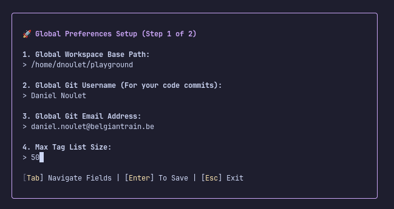

### Dashboard


### Git

Shortcut: ctrl+g\
Select the project you want to clone\
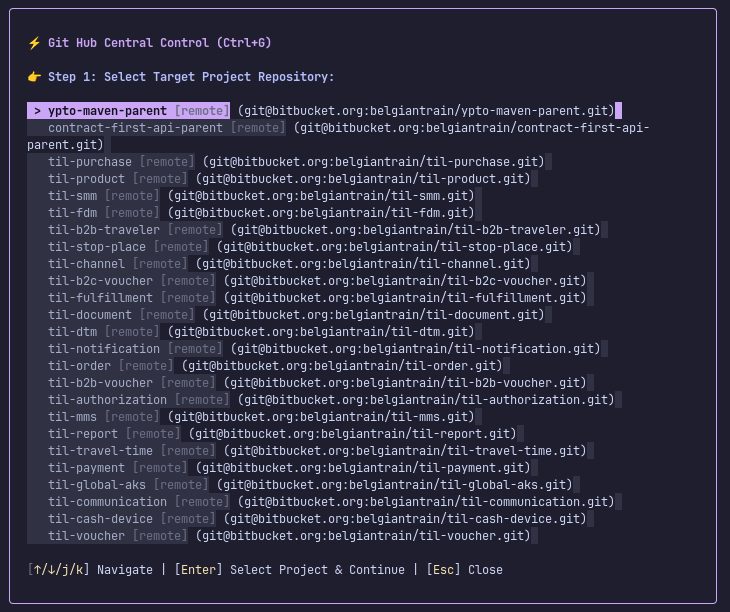\
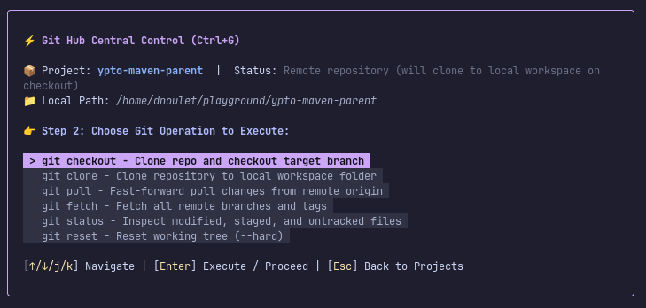\
Select the branch you want to check out\
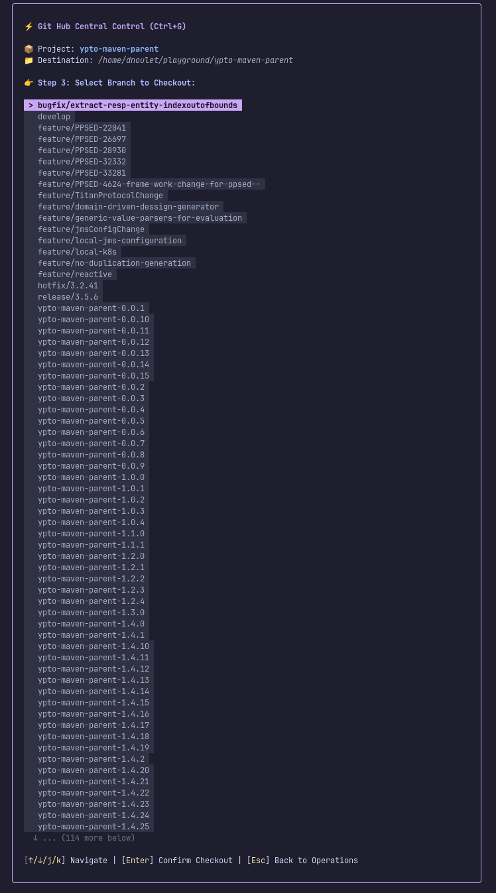\
Project successfully checked out\
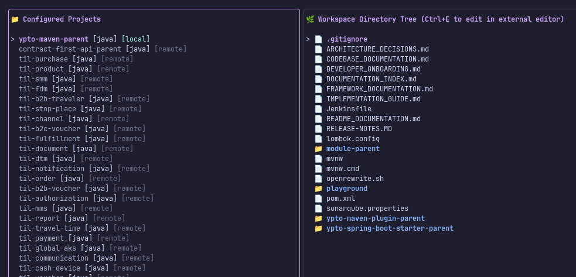

### JDK
Shortcut: ctrl+j\
You can choose between configuring a new jdk or assigning a configured one\
\
\
\


### Mvn 
Shortcut: ctrl+u\
You can choose between configuring a new mvn or assigning a configured one\
\
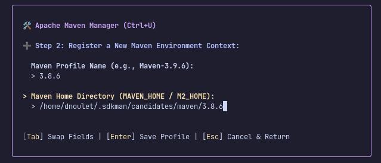\
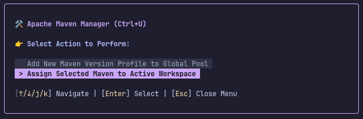\
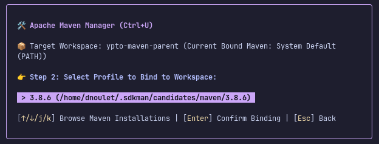

### Building project
Shortcut: ctrl+b\
\
Session runs in the background\
ctrl+s to call the screen\
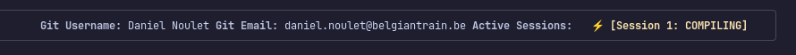\
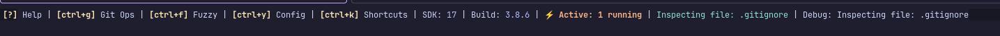

### Deploying the workspace (simulated Rancher/Kubernetes)
Shortcut: ctrl+p\
Resolves the `Deployable` dependency graph for your cloned projects
(`model.ResolveDeployOrder`) and streams a simulated rollout transcript -
namespace, manifests, scheduling, rollout status, service exposure - with
independent services rolling out in parallel waves, just like independent
Kubernetes Deployments would.\
ctrl+s to start the simulated rollout, esc to leave

### Editing a file (Vim-style modal editor)
Shortcut: ctrl+e (while a file is focused in the workspace tree)\
Opens in **Normal mode** (shown as `-- NORMAL --` in the status line), just
like real Vim:
- `i` / `a` / `A` / `I` — enter **Insert mode** (before/after cursor, end/start of line)
- `o` / `O` — open a new line below/above and enter Insert mode
- `h` `j` `k` `l` — move left/down/up/right · `0` / `$` — line start/end
- `gg` / `G` — jump to top/bottom of the file
- `x` — delete character under cursor · `dd` — delete current line
- `esc` — Insert → Normal mode; in Normal mode, cancels and discards changes
- `:w` save · `:q` quit (refuses if there are unsaved changes) · `:wq` save & quit · `:q!` force quit, discarding changes

`ctrl+s` remains available as a quick "save & quit" alias in any mode. The
status line also doubles as the live `:` command prompt while typing a command,
and the editor opens full-screen and scrolls automatically to keep the
cursor's line in view.

### Interactive terminal
Shortcut: ctrl+t\
Opens a real shell (your `$SHELL`, as a login shell) in the selected project's folder, with that
project's JDK/Maven profile on `PATH`. It is a genuine terminal: `cd` and exported variables stick,
`vim`, `less`, `htop` and friends work, and esc / ctrl+c / ctrl+d reach the program as usual.
Shells keep running when you go back to the dashboard (the footer shows how many), so you can
come back to a long-running command later.

| Key (default) | Action |
|---|---|
| ctrl+] | back to the dashboard (shells keep running) |
| alt+t | new tab - pick any project |
| alt+n / alt+p | next / previous tab |
| alt+w | close the tab (ends its shell) |

All of these can be changed with ctrl+k. A `*` on a tab means it printed something you haven't
seen; `✗` means its shell exited (enter closes it). Not available on Windows yet.

### Teams & projects
Shortcut: ctrl+y → "Manage Team Manifests" / "Manage Projects"\
Each team keeps a `go-dark.json` manifest at the root of a git repository and everyone
subscribes to it by git URL; go-dark clones it and pulls updates at startup. You can follow
several teams, and dependencies can cross teams (`"depends_on": ["other-team/lib"]`).
Projects you add yourself are *local* and can be removed again; team projects follow their manifest.

```json
{
  "team": "belgiantrain",
  "base_git_url": "git@bitbucket.org:belgiantrain/",
  "projects": [
    { "name": "ypto-maven-parent", "type": "maven", "buildable": true },
    { "name": "til-order", "type": "maven", "buildable": true, "deployable": true,
      "depends_on": ["contract-first-api-parent"],
      "commands": { "test": "mvn clean verify" } }
  ]
}
```

`type` picks a command preset (`maven`, `gradle`, `npm`, `go`, `docker`) used by the build
modal (ctrl+b) and the startup pipeline; `commands` overrides or adds commands per project.
`git_url` defaults to `base_git_url + name + ".git"`. The belgiantrain manifest lives in
[examples/belgiantrain/go-dark.json](examples/belgiantrain/go-dark.json).

### Profile
Shortcut: ctrl+y\
\


### Edit Shortcuts
Shortcut: ctrl+y\
\
or using shortcut to go direct to the modal: ctrl+k\
\
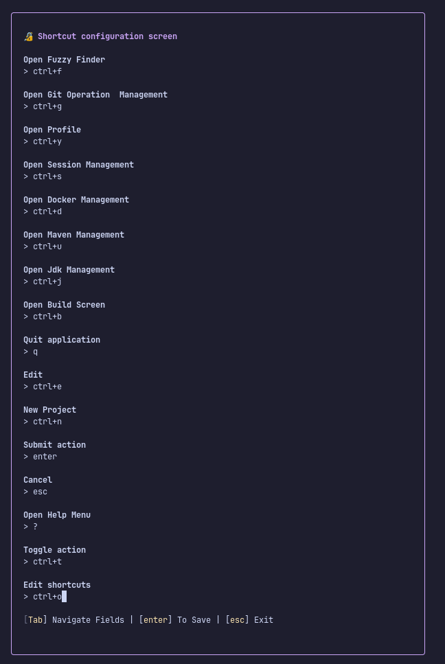\


## Tech Stack

### TUI
bubble tea: https://github.com/charmbracelet/bubbletea

### Engine
go: https://go.dev/

### Run application
```bash
go run .
```

Logfile: debug.log

### Debugging

Before running this configuration, start your application and Delve as described below.

Allow Delve to compile your application:

```bash
dlv debug --headless --listen=:2345 --api-version=2 --accept-multiclient
```

Or compile the application using Go 1.18 or newer:

```bash
go build -gcflags "all=-N -l" github.com/exr462/go-dark
```

and then run it with Delve using the following command:

```bash
dlv --listen=:2345 --headless=true --api-version=2 --accept-multiclient exec ./go-dark
```
### Running tests
```bash
go test ./...
```

### Engineering notes
See [docs/ENGINEERING_NOTES.md](docs/ENGINEERING_NOTES.md) for a running log
of bugs found/fixed, the dependency & deploy engine design, and a test
coverage map.
