# Go Dark

## User guide

### Initial Step
Fill in the following fields:\
- workspace: where the projects are stored
- git username: to push (still a feature to do) than those info are used
- git email: same as above
- max tag list size: only shows X amount of tags
- team manifest git URL (optional): subscribes to your team's project list (see below)


### Dashboard

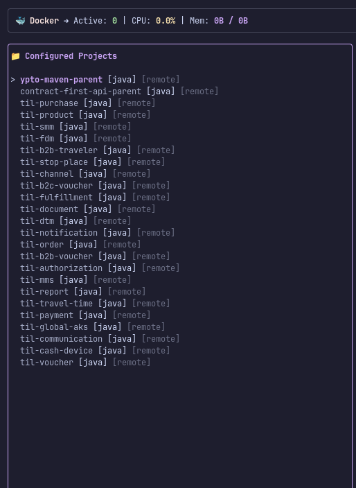

### Git

Shortcut: ctrl+g\
Select the project you want to clone\
\
\
Select the branch you want to check out\
\
Project successfully checked out\


### JDK
Shortcut: ctrl+j\
You can choose between configuring a new jdk or assigning a configured one\
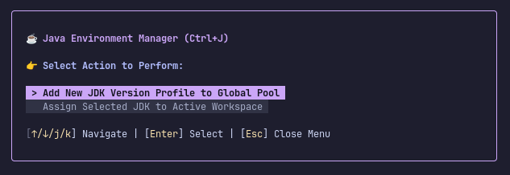\
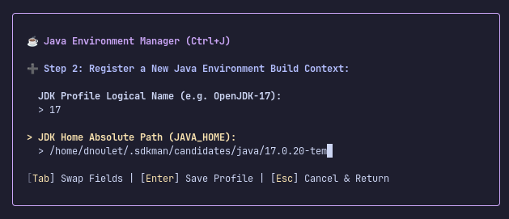\
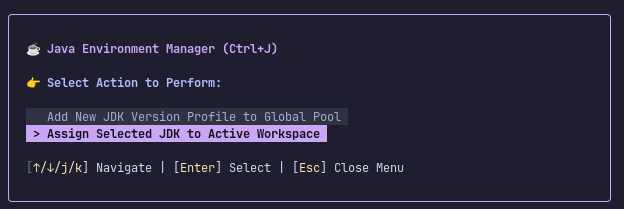\
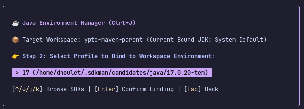

### Mvn 
Shortcut: ctrl+u\
You can choose between configuring a new mvn or assigning a configured one\
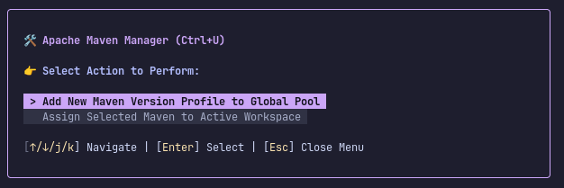\
\
\


### Building project
Shortcut: ctrl+b\
Pick one of the project's commands (from its type's preset or its own `commands`) and run it.
The build runs in the background and its output streams into the screen live; you can close
the screen and it keeps going (the project shows `(#id ⏳)` and the footer reports the result).
ctrl+t opens the running build in the terminal pane, where ctrl+c cancels it.\
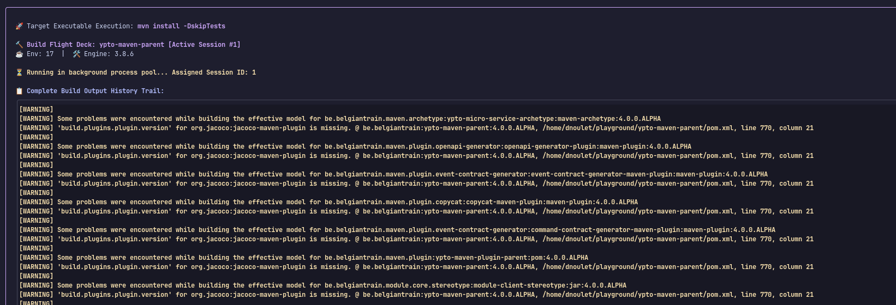

### Sessions
Shortcut: ctrl+o\
Lists every session: builds, the startup pipeline's per-module builds and terminal shells,
with a live preview. Enter opens one in the terminal pane, d closes it (killing it if it is
still running).

### Local environment (installer)
Shortcut: ctrl+l\
Installs and runs your team's **local Rancher environment**: Rancher with its embedded k3s
cluster in one docker container, set up like the clusters behind dev/tst/acc/prd so the team's
charts deploy unchanged. What it is comes from the team manifest's `environment` section (see
[Teams & projects](#teams--projects)); go-dark derives every name from it so two teams' environments
(or the old bash sandbox) don't clash:

| | belgiantrain example |
|---|---|
| Install dir | `~/.local/share/go-dark/env/<team>/` → `…/env/belgiantrain/` |
| Compose project / container | `go-dark-<team>` / `go-dark-<team>-rancher` |
| Kube context | `go-dark-<team>`, server `https://127.0.0.1:6550` (loopback only) |
| Namespace | `til-lcl`, labelled `belgiantrain.be/environment=lcl` |
| Ingress | NGINX Inc 2.8.1 (k3s HelmChart), IngressClass `nginx-lcl` set as default, mergeable master for `api.til.lcl-intern-belgiantrain.be` with TLS from mkcert; the host's 80/443 go straight to its NodePorts |
| Platform | Stakater Reloader 2.2.19, node label `belgiantrain.be/env-lcl=selected`, etcd quota 8 GiB + 30 min compaction + 30 min event TTL, CoreDNS pointed at Docker's resolver when the host blocks public DNS |
| Database | Oracle Free (`gvenzl/oracle-free:23-slim`) StatefulSet on a hostPath under `/var/lib/rancher`, with each service's users from its `helm/*/config/dev/*.properties`: app user (`spring.datasource.username`) and schema owner (`spring.liquibase.user`), DML ANY grants and a logon trigger when they differ, verified after creation |
| Rancher UI | `https://rancher.<domain>` through the same NGINX (admin / developer) |

**Generated files.** go-dark writes `docker-compose.yaml`, `k3s/config.yaml`, `certs/`
(mkcert certificate + the ISRG Root YR the chart repositories chain to), `platform/*.yaml`
(namespace, NGINX, Reloader, master ingress, TLS secret, Oracle, Rancher UI) and a `README.md`
into the install dir. Read them, and run them without go-dark:
`docker compose -f docker-compose.yaml up -d`, then `kubectl --context go-dark-<team> apply -f platform/`.

**Preflight, never an install.** The screen checks docker (running, ≥ 4 CPU and ~8 GB, else a
warning), docker compose, kubectl, helm, mkcert, and that ports 80, 443 and 6550 are free.
Anything missing comes with the command for your OS (brew / winget / apt). go-dark never
installs software or edits system files itself. If another compose project holds the ports -
the old `local-cicd-sandbox` with its `rancher` and `traefik` containers - it says so and `o`
stops that project (`docker compose -p local-cicd-sandbox stop`; its volumes and files are kept).

| Key | Action |
|---|---|
| i | install / repair - idempotent: writes the files, `mkcert` for the hosts, `docker compose up -d`, waits for k3s, writes the kube context (`kubectl config set-cluster/set-credentials/set-context`; your current context is never changed), fixes CoreDNS, applies the platform, waits for NGINX / Reloader / Oracle, creates the database users |
| s / t | start / stop the container (the cluster and database are kept) |
| u | uninstall: `y` removes the container and keeps the data volumes, `V` removes the volumes too |
| h | hosts file: runs `sudo tee -a /etc/hosts` in the embedded terminal, so you type your password there; on Windows the elevated PowerShell command is shown instead |
| o | stop the old sandbox holding the ports (after `y`) |
| l | open the running / last action's log in the terminal pane |
| r / tab | re-check / next team's environment |

Every action runs as a session of `go-dark env <action> --manifest … --dir …` (ctrl+o lists
them), which also works from a shell: `go-dark env status --team belgiantrain`. The status
line shows the container, k3s readiness, the etcd size, the ingress and database rollouts, the
Helm releases and whether the hosts file has every host.

### Shipping to the local cluster
Shortcut: ctrl+p\
enter runs the whole train: **versions → build → images → deploy**.
- *Versions*: if projects are referenced at mixed versions the first enter says so (`v` opens
  the alignment screen); a second enter ships anyway.
- *Build*: `mvn clean install -DskipTests` (each project's pipeline command) in dependency waves.
- *Images & deploy*: below. `d` runs only this part (no rebuild).

The train keeps going if you leave the screen; `x` cancels whatever stage is running.

Deploying targets the team's **local environment** (above, ctrl+l): the kube context
`go-dark-<team>`, its namespace and its database. Every cloned, deployable service with a
ypto-style `helm/<chart>` is listed in dependency waves with a switch:

| Key | Action |
|---|---|
| ↑/↓, space | highlight a service, switch it on or off (remembered in `config.json` → `ship_disabled`) |
| enter / d | ship (build + deploy) / deploy only, the switched-on services as **one Helm release** |
| i | quick iteration for the highlighted service: `docker build`, load into the cluster, `kubectl rollout restart` of its deployment (same tag, `imagePullPolicy: Never`) - no helm upgrade |
| m | uninstall per-service releases from before the umbrella (e.g. an old `til-order` release): Helm refuses to adopt resources owned by another release, so this is needed once |
| z / u | scale the other deployments in the namespace to 0 to make room / scale them back |
| s | start the environment's container if it is stopped |

How the one release is built:
1. **Images**, per service: `docker build -t <image>:<version>` with your normal docker, then
   `docker save | docker exec -i <container> /usr/bin/ctr -n k8s.io images import -` (piped in
   Go, no shell, so it works on Windows too) - no registry involved. The image is
   `main.image`/`main.version` from the chart's untracked `values.local-rancher.yaml` if there
   is one, else `local/<chart>:<pom version>`.
2. **Umbrella chart** `<install dir>/charts/<application>-umbrella` (e.g. `til-umbrella`),
   regenerated on every deploy: every deployable service's chart is a staged **subchart** (the
   repo is untouched) with a `<chart>.enabled` condition, configured **like dev, except the
   database**:
   - `Chart.yaml` gets a semver instead of `{JENKINS_VERSION}`;
   - `config/dev` and `secrets/dev` are copied to `config/lcl` and `secrets/lcl`, with the JDBC
     URLs pointed at the environment's Oracle (`spring.datasource.url`, ...);
   - values are layered like the pipeline - `values.yaml`, the manifest's `values_files[dev]`,
     your `values.local-rancher.yaml` (optional), then go-dark's overlay (`ypto.env`/`main.env`
     = `lcl`, the local image with `imagePullPolicy: Never`, the node's architecture, one
     replica, no Dynatrace, the local database password for the `data:` secrets that name a
     database) - and, because every chart uses the same `main`/`ypto`/`data` keys, nested per
     subchart in the umbrella's `values.go-dark.yaml`.
3. `helm upgrade --install <application> <umbrella> -f values.go-dark.yaml --wait` (Spring +
   Liquibase can take minutes).

The service is then on `https://api.til.lcl-intern-belgiantrain.be/<path>` (e.g. `/order`);
NGINX strips `/<service>` and sends it as `X-Forwarded-Prefix`, so Swagger UI links work.
Every step runs as a session (ctrl+o to watch it); the first failure stops the run and its log
stays in the inspector.

Without a team manifest environment the screen falls back to `config.json` → `local_cluster`
(the old sandbox's `rancher-lcl` context) with one release per service, and says so.

**Safety:** go-dark only deploys to the contexts it owns (`go-dark-<team>`, plus the legacy
`rancher-lcl`), and only when the context's API server is a literal loopback address; every
kubectl/helm call names the context and namespace explicitly. Other contexts in your
kubeconfig - production included - are refused, even if configured, and your current context
is never changed.

### Editing a file (Vim-style modal editor)
Shortcut: ctrl+e (while a file is focused in the workspace tree)\
Opens in **Normal mode** (shown as `-- NORMAL --` in the status line), just
like real Vim:
- `i` / `a` / `A` / `I` — enter **Insert mode** (before/after cursor, end/start of line)
- `o` / `O` — open a new line below/above and enter Insert mode
- `h` `j` `k` `l` — move left/down/up/right · `0` / `$` — line start/end
- `gg` / `G` — jump to top/bottom of the file
- `x` — delete character under cursor · `dd` — delete current line
- `esc` — Insert → Normal mode; in Normal mode, cancels and discards changes
- `:w` save · `:q` quit (refuses if there are unsaved changes) · `:wq` save & quit · `:q!` force quit, discarding changes

`ctrl+s` remains available as a quick "save & quit" alias in any mode. The
status line also doubles as the live `:` command prompt while typing a command,
and the editor opens full-screen and scrolls automatically to keep the
cursor's line in view.

### Dependency graph
Shortcut: ctrl+r\
Shows the cloned projects in build waves (from the team manifest and your local overrides) and
what their `pom.xml` files actually say:
- `+name` - the poms use that project, but the manifest doesn't list it as a dependency
- `?name` - the manifest lists it, but the poms don't use it
- `⚠n` - n references to another workspace project use an older version than that project is at

enter shows every pom reference of the selected project (file, version, and the `${property}` it
comes from); `a` / `A` accept the `+` suggestions of one / all projects as local overrides
(the team manifest itself is never changed); `r` rescans.

### Aligning versions
ctrl+y → "Align Workspace Versions" (or `v` on the dependency graph)\
Lists every workspace project that other projects reference at inconsistent versions, e.g.
`ypto-maven-parent` used at 3.4.9 … 3.5.7 across the services. Per project pick the target with
←/→ - its version in the workspace, its newest release tag, or keep - and `p` previews every
changed line (`↓ downgrade` is flagged). enter (twice) applies it: in each repo that needs
changes go-dark edits only the version text (the `<version>` or the `${property}` it comes from)
and commits just those poms on branch `go-dark/align-versions`. It never pushes. A repo is
skipped, and reported, when one of its poms has uncommitted changes or the branch already exists
without being checked out.

### Interactive terminal
Shortcut: ctrl+t\
Opens a real shell (your `$SHELL`, as a login shell) in the selected project's folder, with that
project's JDK/Maven profile on `PATH`. It is a genuine terminal: `cd` and exported variables stick,
`vim`, `less`, `htop` and friends work, and esc / ctrl+c / ctrl+d reach the program as usual.
Shells keep running when you go back to the dashboard (the footer shows how many), so you can
come back to a long-running command later.

| Key (default) | Action |
|---|---|
| ctrl+] | back to the dashboard (shells keep running) |
| alt+t | new tab - pick any project |
| alt+n / alt+p | next / previous tab |
| alt+w | close the tab (ends its shell) |

All of these can be changed with ctrl+k. A `*` on a tab means it printed something you haven't
seen; `✗` means its shell exited (enter closes it). Not available on Windows yet.

### Teams & projects
Shortcut: ctrl+y → "Manage Team Manifests" / "Manage Projects"\
Each team keeps a `go-dark.json` manifest at the root of a git repository and everyone
subscribes to it by git URL; go-dark clones it and pulls updates at startup. You can follow
several teams, and dependencies can cross teams (`"depends_on": ["other-team/lib"]`).
Projects you add yourself are *local* and can be removed again; team projects follow their manifest.

```json
{
  "team": "belgiantrain",
  "base_git_url": "git@bitbucket.org:belgiantrain/",
  "projects": [
    { "name": "ypto-maven-parent", "type": "maven", "buildable": true },
    { "name": "til-order", "type": "maven", "buildable": true, "deployable": true,
      "depends_on": ["contract-first-api-parent"],
      "commands": { "test": "mvn clean verify" } }
  ]
}
```

`type` picks a command preset (`maven`, `gradle`, `npm`, `go`, `docker`) used by the build
modal (ctrl+b) and the startup pipeline; `commands` overrides or adds commands per project.
`git_url` defaults to `base_git_url + name + ".git"`. The belgiantrain manifest lives in
[examples/belgiantrain/go-dark.json](examples/belgiantrain/go-dark.json).

A manifest can also declare the team's **local environment**, which the installer (ctrl+l) and
the ship screen (ctrl+p) use. Nothing in it is specific to one team:

```json
"environment": {
  "name": "lcl",                              "application": "til",
  "config_from": "dev",                       "domain": "lcl-intern-belgiantrain.be",
  "hosts": { "api": "api.{application}.{domain}", "rancher": "rancher.{domain}" },
  "namespace": "til-lcl",
  "values_files": { "dev": "values.Development.yaml", "tst": "values.Test.yaml",
                    "acc": "values.Acceptance.yaml", "prd": "values.Production.yaml" },
  "ingress":  { "controller": "nginx-inc", "strip_prefix": true },
  "database": { "type": "oracle-free", "users_from": "config", "users": [] }
}
```

- `name` is the chart environment (`ypto.env`, node label `belgiantrain.be/env-<name>`,
  IngressClass `nginx-<name>`); `application` names the umbrella release; `config_from` is the
  real environment whose values, config and secrets the charts are copied from.
- `hosts` may use `{domain}`, `{application}` and `{name}`; `api` and `rancher` are required
  (defaults shown). `namespace` defaults to `<application>-<name>`.
- `ingress.controller` supports `nginx-inc`; `strip_prefix` adds the controller-wide snippet
  that strips `/<service>` and sends `X-Forwarded-Prefix` (for charts routing `/<service>` with
  `nginx.org/rewrites`).
- `database.type` is `oracle-free` or `none`; `users_from: "config"` reads each service's
  `helm/*/config/<config_from>/*.properties`; `users` adds `{ "app": ..., "owner": ... }` pairs.
- `dns_upstream` (optional) forces the resolver CoreDNS forwards to.

Only `application` and `domain` are required; everything is validated when the manifest loads.

### Profile
Shortcut: ctrl+y\
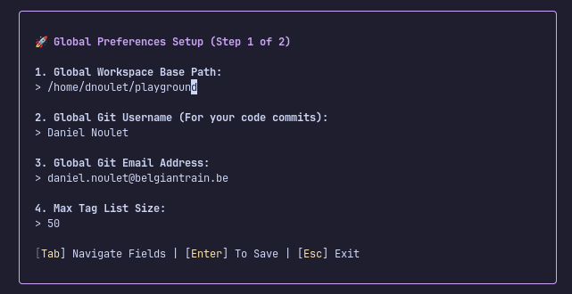\
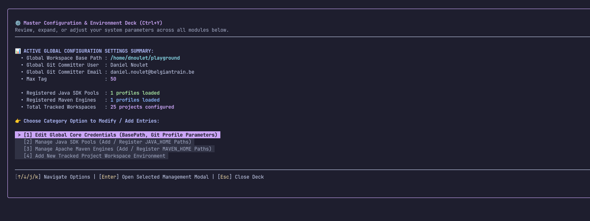

### Edit Shortcuts
Shortcut: ctrl+y\
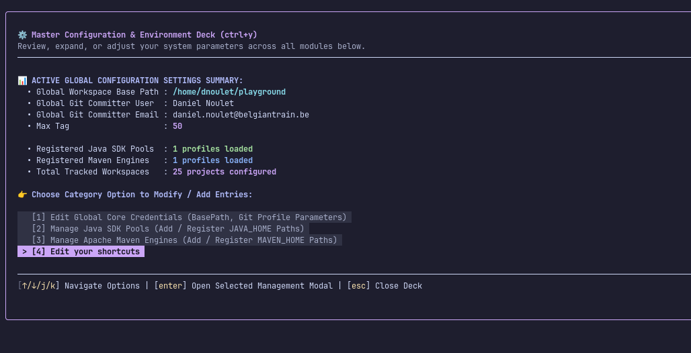\
or using shortcut to go direct to the modal: ctrl+k\
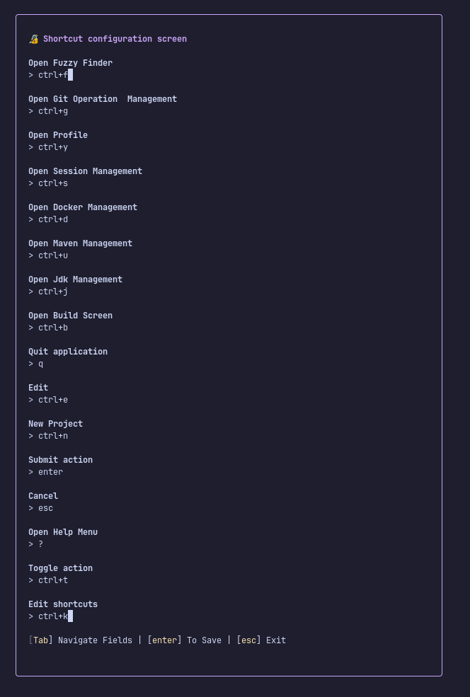\
\
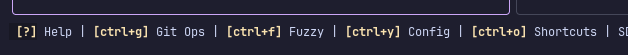

## Tech Stack

### TUI
bubble tea: https://github.com/charmbracelet/bubbletea

### Engine
go: https://go.dev/

### Run application
```bash
go run .
```

Logfile: debug.log

### Debugging

Before running this configuration, start your application and Delve as described below.

Allow Delve to compile your application:

```bash
dlv debug --headless --listen=:2345 --api-version=2 --accept-multiclient
```

Or compile the application using Go 1.18 or newer:

```bash
go build -gcflags "all=-N -l" github.com/exr462/go-dark
```

and then run it with Delve using the following command:

```bash
dlv --listen=:2345 --headless=true --api-version=2 --accept-multiclient exec ./go-dark
```
### Running tests
```bash
go vet ./... && go test -race ./...
# the same on Linux:
docker run --rm -v "$PWD":/src -w /src -v go-dark-modcache:/go/pkg/mod golang:1.27.1 sh -c 'go vet ./... && go test -race ./...'
```
The tests never touch a real cluster: docker, kubectl, helm and mkcert are fake scripts on
`PATH`, and the installer's `go-dark env` sessions re-run the test binary.

### Engineering notes
See [docs/ENGINEERING_NOTES.md](docs/ENGINEERING_NOTES.md) for a running log
of bugs found/fixed, the dependency & deploy engine design, and a test
coverage map.
